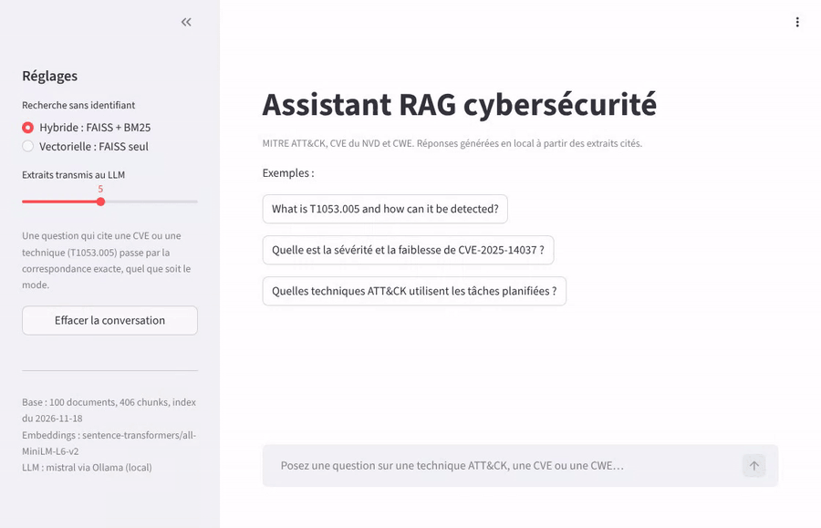
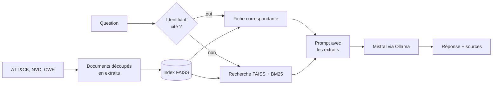

# rag-cyber-mitre-nvd

Assistant de questions-réponses pour l'analyse de menaces. On lui pose une question en langage naturel sur une technique MITRE ATT&CK, une CVE ou une faiblesse CWE, et il répond en français à partir des sources officielles, en citant les extraits utilisés. Le modèle de langage (Mistral 7B) tourne en local avec Ollama.

Projet réalisé en binôme avec [Bilal Medj](https://github.com/MjBilaal) pour le module Cryptographie et algorithmes d'apprentissage du M1 Cybersécurité (INSA Hauts-de-France). Je l'ai ensuite repris pour corriger les défauts de la première version et refaire l'évaluation.



*Le chatbot Streamlit avec Mistral 7B en local : la CVE citée est retrouvée directement, et les extraits transmis au modèle s'affichent sous la réponse (animation accélérée).*

## Pourquoi ce projet

Face à un identifiant dans une alerte ou un bulletin (`CVE-2025-14037`, `T1053.005`), il faut ouvrir la fiche NVD ou la page ATT&CK pour retrouver la sévérité, la faiblesse, le produit concerné ou les journaux à surveiller. Un LLM généraliste répond plus vite, mais il ne connaît pas les CVE publiées après son entraînement et invente volontiers les détails.

L'idée est donc de faire répondre le modèle à partir d'une base locale construite avec MITRE ATT&CK, le flux NVD et le catalogue CWE, et de montrer à chaque fois sur quels extraits il s'appuie.

## Fonctionnement



1. **Données** : le bundle ATT&CK Enterprise (techniques, détection, atténuations), le flux des CVE récentes du NVD (description, score CVSS, CWE, produits) et le catalogue CWE.
2. **Index** : chaque technique ou CVE devient un document découpé en extraits d'environ 120 mots, transformés en vecteurs avec `all-MiniLM-L6-v2` et stockés dans un index FAISS.
3. **Recherche** :
   - si la question cite un identifiant, on récupère directement sa fiche. S'il n'est pas dans la base, l'assistant le dit sans appeler le modèle, au lieu de renvoyer une CVE voisine ;
   - sinon, on combine la recherche vectorielle (FAISS) et la recherche par mots-clés (BM25).
4. **Génération** : les extraits sont envoyés à Mistral (température 0) dans un prompt balisé, avec la consigne de ne répondre qu'à partir de ces extraits et de recopier les noms officiels.

Le [compte rendu](docs/Compte_rendu_P17.pdf) (28 pages) et le [diaporama de soutenance](docs/Diaporama_P17.pdf) détaillent la méthode de la première version.

**Stack** : Python, FAISS, sentence-transformers, rank-bm25, Ollama + Mistral 7B, Streamlit, pytest.

## Résultats

L'évaluation compare le RAG et Mistral seul sur 20 questions (10 ATT&CK, 10 CVE). Pour chaque question, on vérifie que la réponse contient les éléments attendus : identifiant, nom officiel, produit, sévérité, CWE.

| | RAG | Mistral seul |
|---|---|---|
| Éléments attendus présents dans la réponse | 97,5 % | 37,5 % |
| Éléments retrouvés qui n'étaient pas dans la question | 24 sur 25 | 0 sur 25 |
| Réponses fausses données sans réserve | 1 sur 20 | 10 sur 20 |

- Le RAG transmet toujours les bons extraits au modèle : la seule erreur vient de la génération (Mistral répond T1053 au lieu de T1053.005, alors que la bonne fiche arrive en tête).
- Mistral seul se trompe sur toutes les questions ATT&CK (faux noms de techniques) et refuse de répondre sur les CVE récentes en affirmant qu'elles n'existent pas.
- Une relecture des réponses trouve deux défauts que les métriques ne voient pas : un nom de CWE deviné (l'échantillon n'en contient pas) et un nom officiel traduit malgré la consigne.

Les réponses, les extraits transmis et le détail par question sont dans le [rapport d'évaluation](data/eval/results/rapport_evaluation.md). La première version obtenait 0,85 de couverture contre 0,40 pour Mistral seul ([résultats archivés](data/eval/v1/)).

## Sécurité

- **Injection de prompt** : les descriptions de CVE sont écrites par des tiers et finissent dans le prompt. Le contexte est délimité par des balises, les balises présentes dans les extraits sont neutralisées, et le modèle a pour consigne d'ignorer les instructions qu'il y trouve. C'est une atténuation, pas une garantie.
- **Identifiant inconnu** : réponse explicite sans appel au modèle, donc pas de fiche inventée.
- **Tout en local** : seule l'API locale d'Ollama est appelée, aucune clé ni donnée envoyée à un service externe.

## Installation

Prérequis : Python 3.11 à 3.13 et [Ollama](https://ollama.com) lancé, avec le modèle Mistral (`ollama pull mistral`, environ 4 Go).

```bash
git clone https://github.com/MiscuitAtlas/rag-cyber-mitre-nvd.git
cd rag-cyber-mitre-nvd
python -m venv .venv
source .venv/bin/activate          # Windows : .venv\Scripts\activate
pip install -r requirements.txt
```

Construire l'index, au choix :

```bash
# échantillon fourni : 50 techniques et 50 CVE, dont celles de l'évaluation
python -m rag_cyber prepare --sample
python -m rag_cyber index

# ou corpus complet : ATT&CK, CVE des derniers jours, noms des CWE
python -m rag_cyber download --cwe
python -m rag_cyber prepare
python -m rag_cyber index
```

Puis lancer le chatbot (`http://localhost:8501`) ou poser une question en ligne de commande :

```bash
streamlit run app.py
python -m rag_cyber ask "What is T1053.005 and how can it be detected?"
```

- `python -m rag_cyber evaluate` relance l'évaluation (sur l'échantillon).
- Sous Windows, `scripts\evaluer_windows.bat` installe tout et lance l'évaluation en un double-clic.
- Les réglages (modèle, nombre d'extraits, poids de la recherche hybride…) se changent dans un fichier `.env` (voir `.env.example`).

## Tests

```bash
pip install -r requirements-dev.txt
pytest
```

Les 70 tests tournent sans Ollama ni modèle d'embeddings (remplacés par des versions factices). Ils couvrent l'extraction des données, le découpage, les trois modes de recherche, la protection du prompt, les métriques et l'interface Streamlit. Ils sont lancés à chaque push par GitHub Actions.

## Structure

```
rag_cyber/
├── download.py, mitre.py, nvd.py, cwe.py   téléchargement et extraction des données
├── documents.py                            documents et découpage en extraits
├── index.py, retrieval.py                  index FAISS et recherche
├── prompt.py, llm.py, pipeline.py          prompt, client Ollama, chaîne complète
├── evaluation.py                           métriques et rapport
└── cli.py                                  python -m rag_cyber …
app.py                                      chatbot Streamlit
data/                                       échantillon, questions et résultats d'évaluation
docs/                                       compte rendu et diaporama
```

## Limites

- Les métriques ne vérifient que des faits simples (identifiants, noms, sévérités) : une paraphrase fausse passe inaperçue.
- 19 questions sur 20 citent un identifiant : l'évaluation mesure surtout la génération, peu la recherche sémantique.
- Le flux NVD « recent » ne couvre que quelques jours. Pour des CVE plus anciennes, il faudrait ajouter les flux annuels.
- Quand une question cite un identifiant, seule sa fiche est récupérée : « quelles techniques ressemblent à T1053.005 ? » ne renvoie que T1053.005.

## Ce que j'ai appris

- **Les embeddings ignorent les identifiants** : pour le modèle, « CVE-2025-14037 » et « CVE-2025-14038 » ont une similarité de 0,976. D'où la recherche exacte sur les identifiants, complétée par BM25.
- **La langue de la consigne compte** : demander une réponse en français poussait Mistral à traduire les noms officiels (« Filtres de socket »). Lui demander de les recopier tels quels a corrigé le problème.
- **Un format de données peut changer sans prévenir** : ATT&CK v18 a déplacé la détection dans de nouveaux objets. La première version ne plantait pas, elle produisait simplement des champs vides. Un test vérifie maintenant que chaque technique a bien une stratégie de détection.

## Auteurs

Projet réalisé en Master 1 Cybersécurité – Défense des systèmes d'information (INSA Hauts-de-France), puis retravaillé. Dépôt d'origine : [MjBilaal/rag-cyber-mitre-nvd](https://github.com/MjBilaal/rag-cyber-mitre-nvd).

- **Maxence Français** : [portfolio](https://miscuitatlas.github.io) · [LinkedIn](https://www.linkedin.com/in/maxence-fran%C3%A7ais-a039a2307/)
- **Bilal Medj** : [GitHub](https://github.com/MjBilaal)

---

MITRE ATT&CK® et CWE™ sont des marques de The MITRE Corporation ; les données ATT&CK sont reproduites selon leurs [conditions d'utilisation](https://attack.mitre.org/resources/legal-and-branding/terms-of-use/). Les données CVE proviennent de la National Vulnerability Database (NIST).
